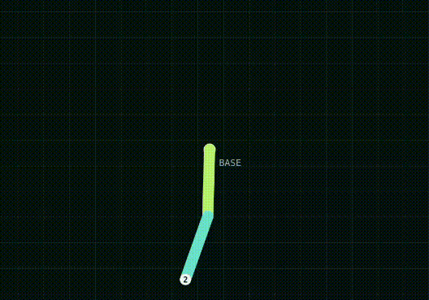
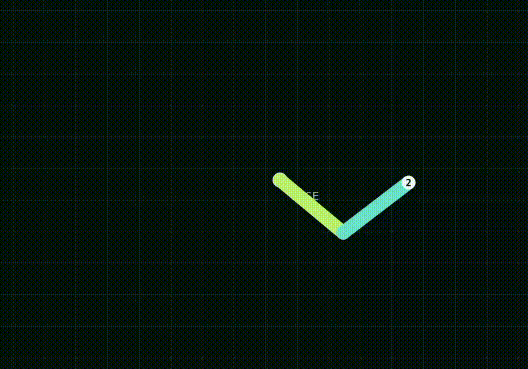

# Pendularm

Pendularm is an interactive planar robot-arm simulator with support for two-link
and three-link arms. It includes configurable arm dynamics, live telemetry, PID
joint control, inverse kinematics (IK), and a browser-based control room.

## Features

- Two-link and three-link arm simulation
- Configurable link lengths, masses, gravity, integrator, and timestep
- Live joint position, velocity, effort, and energy telemetry
- Per-joint PID gain tuning
- Inverse kinematics for individual Cartesian goals
- Automated IK trials that visit multiple targets in sequence

## Requirements

- A C++17 compiler (such as `g++`)
- GNU Make
- Bash
- Node.js and npm

The web interface has no third-party npm dependencies, so no `npm install` step
is required.

## Start the simulator

Open a terminal, change to the project directory, and start the runtime:

```bash
cd path/to/the/project
cd pendularm
make run
```

`make run` builds the project when necessary and starts the complete runtime on
`127.0.0.1:9095`. Leave this terminal running.

By default, Pendularm starts as a two-link arm. You can select the number of
links explicitly when starting it:

```bash
# Two-link arm
ARM_SIM_LINKS=2 make run

# Three-link arm
ARM_SIM_LINKS=3 make run
```

The link count is selected at startup. Stop the runtime with `Ctrl+C` before
switching between the two-link and three-link configurations.

Next, open a **new terminal** and start the web interface:

```bash
cd path/to/the/project
cd pendularm/web
npm start
```

Click the website address printed in the terminal, or open
[http://127.0.0.1:8080](http://127.0.0.1:8080) in a browser.



The **Simulation parameters** panel in the web UI lets you change each link's
length and mass. You can also adjust gravity, the integration method, and the
simulation timestep, then apply the new values without restarting the runtime.

## Control the arm with IK and PID

Inverse kinematics and PID work together to move the arm:

1. IK converts a Cartesian end-effector target into desired joint angles.
2. The PID controller compares those desired angles with the current angles.
3. PID applies joint effort until the arm reaches the target.

To control the arm from the web UI:

1. In **PID controller**, set the `Kp`, `Ki`, and `Kd` values for each joint and
   click **Set PID gains**.
2. Click **Start PID**.
3. In the **IK goal** panel at the top right, enter `X` and `Y`. You may also set
   the end-effector orientation `Phi`, tolerance `Epsilon`, and success hold
   time.
4. Click **Send goal**. The IK solver finds the joint-angle target and the PID
   controller drives the arm toward it.

You can cancel the current target with **Cancel goal** or stop joint control
with **Stop PID**.

## Run an IK trial

An IK trial sends multiple targets in sequence so you can watch the arm solve
and chase each goal automatically.

1. Start the PID controller first.
2. In **IK trial**, choose the goal duration, position tolerance, and success
   hold time.
3. Click **Start trial**.

Use **Skip goal** to advance to the next target or **Stop / pause** to stop the
trial.



## How it is organized

The C++ runtime contains the arm simulation, integrator, IK, IK action, PID, and
trial nodes. These nodes communicate through the local TCP/JSON hub. The browser
UI displays the published state and sends commands through a small local
WebSocket-to-TCP bridge; physics and control calculations remain in the C++
runtime.
